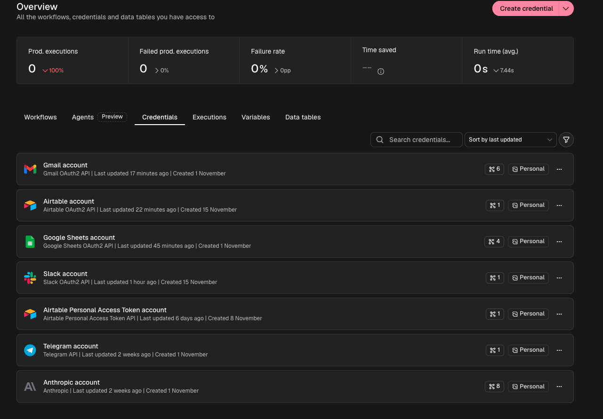
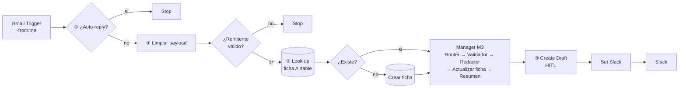
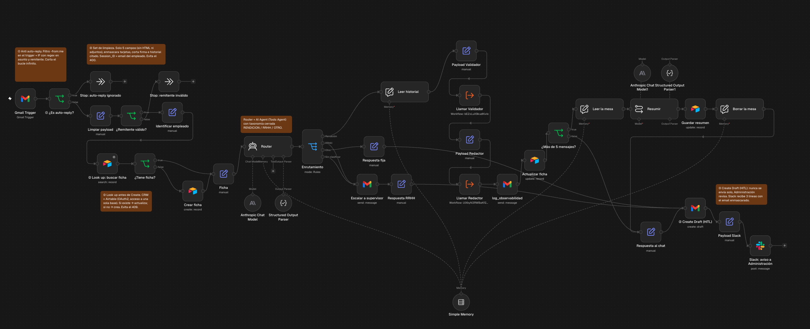
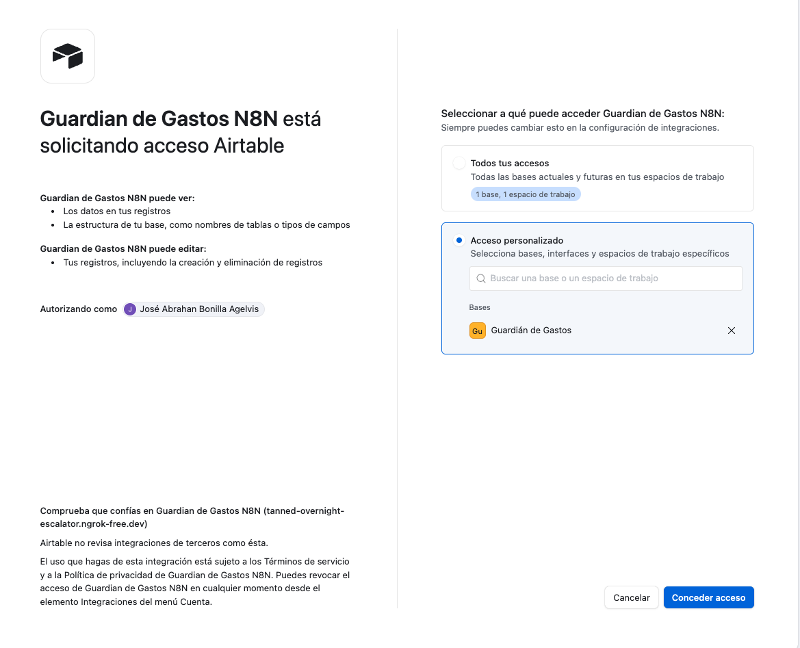
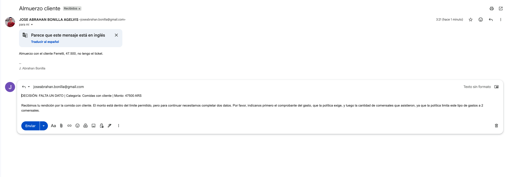
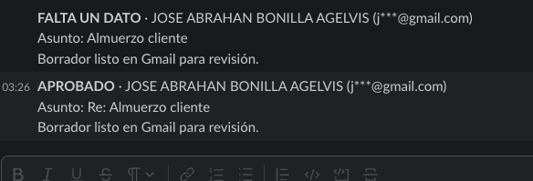

# 🛡️ Guardián de Gastos · Agentes autónomos con n8n


Proyecto integrador del curso **AI Automation Avanzado** de Coderhouse. Un mismo agente que crece módulo a módulo: de un agente base con una herramienta a un sistema multi-agente con memoria, conectado a las herramientas reales de la empresa.

## 📌 El caso

**Textil Nordelta** recibe unas 400 rendiciones de gastos por mes, escritas en texto libre y con datos incompletos. El Guardián de Gastos lee cada rendición, deduce la categoría, consulta la política de la empresa y responde una de tres decisiones:

| Decisión | Cuándo |
|---|---|
| ✅ **APROBADO** | Dentro del límite y cumple los requisitos de la categoría |
| 🟡 **FALTA UN DATO** | Pide el dato puntual que falta (monto, comprobante, comensales…) |
| 🔴 **ESCALADO** | Supera el límite, requiere jefatura o pide una excepción: decide un humano |

## 🗺️ Avance por módulo

| Módulo | Qué suma | Entrega | Estado |
|---|---|---|---|
| M1 · Agente base | AI Agent + System Prompt de 4 bloques + tool de política + log | [`checkpoint1/`](checkpoint1/) · JSON | ✅ |
| M2 · Multi-agente | Manager con Router + Worker Validador + Worker Redactor (sub-workflows) | [`checkpoint2/`](checkpoint2/) · PDF | ✅ |
| M3 · Memoria | Ficha por empleado en Airtable + resumen automático cada 6 mensajes | [`checkpoint3/`](checkpoint3/) · PDF | ✅ |
| M4 · Integraciones | Gmail como entrada, Airtable como CRM, Slack como canal del equipo, con guardrails | [`checkpoint4/`](checkpoint4/) · JSON | ✅ |
| M5 · RAG | La política pasa a ser un manual consultado por búsqueda semántica | PDF | ⏳ |
| M6 · Voz | Rendición por audio | PDF | ⏳ |
| M7 – M11 | Diseño vertical, supervisor, gobernanza, costos y proyecto final | PDF | ⏳ |

---

## 🔌 Checkpoint 4 · Integraciones

Las rendiciones ahora llegan **por mail**. El Manager del M3 (con su memoria) se conecta a tres herramientas reales, todas por **OAuth2**:

| Rol | Herramienta | Qué hace |
|---|---|---|
| Casilla de correo | **Gmail** | Recibe las rendiciones y guarda la respuesta como **borrador** en el mismo hilo |
| CRM | **Airtable** | Ficha del empleado: datos, estado del caso, resumen y próximo paso |
| Canal del equipo | **Slack** (`#rendiciones`) | Aviso corto a Administración; 🚨 si el caso es ESCALADO o RRHH |



### Flujo





### Los 4 guardrails de la rúbrica

Los números ①②③④ en el lienzo son los de la rúbrica, no el orden del flujo.

| # | Nodo | Qué evita | Cómo |
|---|---|---|---|
| ① | **IF anti auto-reply** | Bucle infinito de respuestas automáticas | Filtro `-from:me` en el trigger + IF (OR) con regex sobre el asunto (`auto-reply`, `out of office`, `fuera de la oficina`, `undeliverable`…) y el remitente (`no-reply`, `mailer-daemon`…). Las respuestas "Re:" del empleado **sí** entran: son legítimas. |
| ② | **Look up antes de Create** | Error 409, empleados duplicados | Busca la ficha por `Session_ID` (email). Si existe la actualiza; si no, la crea. |
| ③ | **Create Draft** | Respuestas sin supervisión | El agente nunca envía: deja un borrador en el hilo del empleado y Administración lo revisa y envía. |
| ④ | **Set de limpieza** | Error 400 y payloads pesados | Solo pasan 5 campos (`sessionId`, `nombre`, `asunto`, `chatInput`, `threadId`), sin HTML ni adjuntos. Corta firma e historial citado, enmascara tarjetas. Un IF valida el email antes de tocar el CRM. Antes de Slack, otro Set deja solo 3 líneas con el email enmascarado. |

### Mínimo privilegio

- **Airtable OAuth2**: solo los scopes `data.records:read`, `data.records:write` y `schema.bases:read`, con acceso a **una sola base** (*Guardián de Gastos*).
- **Gmail**: el flujo solo lee la bandeja y crea borradores. El único envío es el log interno de observabilidad a la propia casilla.
- **Slack**: publica únicamente en `#rendiciones`. Los mensajes salen con el usuario que autorizó la conexión (token de usuario de OAuth2).



### Pruebas de regresión

| # | Mail de prueba | Resultado |
|---|---|---|
| 1 | `Automatic reply: Fuera de la oficina` | Se detiene en *Stop: auto-reply ignorado* |
| 2 | Remis de 12.400, empleado nuevo | Crea la ficha · borrador APROBADO · aviso en Slack |
| 3 | Mismo empleado, otra rendición | No duplica la ficha (`Mensajes` = 2) |
| 4 | Tazas de regalo, 21.000, con número de tarjeta | ESCALADO · 🚨 en Slack · tarjeta como `[NUMERO-ENMASCARADO]` |
| 5 | Almuerzo de 47.500 sin ticket | FALTA UN DATO: pide comprobante y comensales |
| 6 | Respuesta "Re:" con los datos | Entra al flujo, usa la memoria y sale APROBADO |

| Borrador en Gmail (HITL) | Aviso en Slack |
|---|---|
|  |  |

---

## 🏗️ Arquitectura de agentes (M2 – M3)

- **Manager**: identifica al empleado, lee su ficha, clasifica el mensaje y delega. Toda la memoria vive acá.
- **Router**: AI Agent (Tools Agent) con taxonomía cerrada `RENDICION / RRHH / OTRO`.
- **Worker 1 · Validador**: AI Agent con la tool `consultar_politica_de_gastos`. Recibe la ficha entre `[INICIO DE CONTEXTO COMPARTIDO]` y `[FIN DEL CONTEXTO COMPARTIDO]` y devuelve `{status, data}`.
- **Worker 2 · Redactor**: convierte la decisión en un mensaje para el empleado. No tiene herramientas ni puede cambiar la decisión.
- **Memoria**: ventana corta (Simple Memory) + ficha persistente en Airtable; al pasar 5 mensajes se resume en JSON fijo y se limpia la ventana.
- **Guardrails generales**: Max Iterations, contratos de error en cada Worker, timeout de 1 minuto y escalamiento a humanos.

## 🧰 Stack

| Pieza | Uso |
|---|---|
| **n8n** (self-hosted en Docker) | Orquestación de todos los flujos |
| **Claude Haiku 5.5** (Anthropic) | Router, Validador, Redactor y resumidor |
| **Gmail** | Entrada de rendiciones, borradores y log de observabilidad |
| **Airtable** | CRM / memoria persistente: una ficha por empleado |
| **Slack** | Avisos al equipo de Administración |
| **Google Sheets** | Política de gastos (8 categorías con límites y reglas) |
| **ngrok** | URL pública fija para OAuth y webhooks |

## 📁 Estructura

```
n8n-ai-automation/
├── checkpoint1/   Agente base (JSON)
├── checkpoint2/   Arquitectura multi-agente (JSON + PDF)
├── checkpoint3/   Memoria persistente y resumen (JSON + PDF)
├── checkpoint4/   Integraciones (checkpoint4_joseabrahan_bonilla.json + img/)
└── README.md
```

## ▶️ Cómo importarlo

1. En n8n: **Workflows → Import from File** → `checkpoint4/checkpoint4_joseabrahan_bonilla.json`. Importa también los Workers de `checkpoint2/` y reasigna su ID en los nodos *Llamar Validador* y *Llamar Redactor*.
2. Crea las credenciales: **Gmail OAuth2**, **Airtable OAuth2**, **Slack OAuth2**, **Google Sheets OAuth2** y **Anthropic**. El JSON no trae claves, solo los nombres de las credenciales.
3. Apunta los nodos a tus recursos: base de Airtable (tabla *Memoria*), canal de Slack y planilla de política.
4. Mándate un mail desde **otra cuenta** (el trigger ignora los propios) y ejecuta el workflow. Revisa Borradores en Gmail y el canal de Slack.

## 🔒 Seguridad

- Ningún archivo del repo contiene tokens ni contraseñas: las credenciales viven cifradas en la instancia de n8n.
- Al modelo y a Slack nunca llegan números de tarjeta ni el mail completo.
- La memoria guarda solo resúmenes y datos clave, nunca la conversación completa ni datos bancarios.

---

Hecho por **José Abrahan Bonilla** · Lima, Perú · Curso AI Automation Avanzado · Coderhouse 2026
