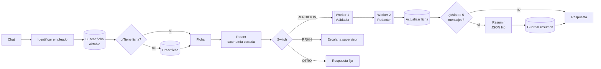

# 🛡️ Guardián de Gastos · Agentes autónomos con n8n


Proyecto integrador del curso **AI Automation Avanzado** de Coderhouse. Un mismo agente que crece módulo a módulo: de un agente base con una herramienta a un sistema multi-agente con memoria persistente.

## 📌 El caso

**Textil Nordelta** recibe unas 400 rendiciones de gastos por mes, escritas en texto libre y con datos incompletos. El Guardián de Gastos lee cada rendición, deduce la categoría, consulta la política de la empresa y responde una de tres decisiones:

| Decisión | Cuándo |
|---|---|
| ✅ **APROBADO** | Dentro del límite y cumple los requisitos de la categoría |
| 🟡 **FALTA UN DATO** | Pide el dato puntual que falta (monto, comprobante, comensales…) |
| 🔴 **ESCALADO** | Supera el límite, requiere jefatura o pide una excepción: decide un humano |

## 🗺️ Avance por módulo

| Módulo | Qué suma | Entrega | Estado |
|---|---|---|---|
| M1 · Agente base | AI Agent + System Prompt de 4 bloques + tool de política + log | [`checkpoint1/`](checkpoint1/) · JSON | ✅ |
| M2 · Multi-agente | Manager con Router + Worker Validador + Worker Redactor (sub-workflows) | [`checkpoint2/`](checkpoint2/) · PDF | ✅ |
| M3 · Memoria | Ficha por empleado en Airtable + resumen automático cada 6 mensajes | [`checkpoint3/`](checkpoint3/) · PDF | ✅ |
| M4 · Integraciones | Conectores, CRM, email con borradores y guardrails anti-bucle | JSON | ⏳ |
| M5 · RAG | La política pasa a ser un manual consultado por búsqueda semántica | PDF | ⏳ |
| M6 · Voz | Rendición por audio | PDF | ⏳ |
| M7 – M11 | Diseño vertical, supervisor, gobernanza, costos y proyecto final | PDF | ⏳ |

## 🏗️ Arquitectura actual (M3)



- **Manager**: lee la ficha del empleado, clasifica el mensaje y delega. Toda la memoria vive acá.
- **Worker 1 · Validador**: AI Agent con la tool `consultar_politica_de_gastos`. Recibe la ficha entre `[INICIO DE CONTEXTO COMPARTIDO]` y `[FIN DEL CONTEXTO COMPARTIDO]` y devuelve `{status, data}`.
- **Worker 2 · Redactor**: convierte la decisión en un mensaje para el empleado. No tiene herramientas ni puede cambiar la decisión.
- **Guardrails**: Max Iterations, taxonomía cerrada, contratos de error en cada Worker, timeout de 1 minuto y escalamiento a humanos.

## 🧰 Stack

| Pieza | Uso |
|---|---|
| **n8n** (self-hosted en Docker) | Orquestación de todos los flujos |
| **Claude Haiku 5.5** (Anthropic) | Router, Validador, Redactor y resumidor |
| **Google Sheets** | Política de gastos (8 categorías con límites y reglas) |
| **Airtable** | Memoria persistente: una ficha por empleado |
| **Gmail** | Log de observabilidad y escalamientos |
| **ngrok** | URL pública fija para webhooks y OAuth |

## 📁 Estructura

```
n8n-ai-automation/
├── checkpoint1/   Agente base (JSON)
├── checkpoint2/   Arquitectura multi-agente (JSON de Manager y Workers + PDF)
├── checkpoint3/   Memoria persistente y resumen (JSON + PDF)
└── README.md
```

## ▶️ Cómo probarlo

1. En n8n: **Workflows → Import from File** y elige los JSON de la carpeta del módulo.
2. Crea tus credenciales: **Anthropic**, **Google** (Sheets y Gmail, OAuth2) y **Airtable** (Personal Access Token). Los JSON no traen claves, solo los nombres de las credenciales.
3. Apunta los nodos a tus propios recursos: la planilla de política, la base de Airtable y tu correo.
4. Abre el chat del Manager y prueba, por ejemplo:
   - *"Cargo 12.400 de un remis del aeropuerto a la oficina, el 14 de agosto."* → APROBADO
   - *"Compré 3 tazas con el logo para regalarle al proveedor nuevo, 21.000."* → ESCALADO

## 🔒 Seguridad

- Ningún archivo del repo contiene tokens ni contraseñas: las credenciales viven cifradas en la instancia de n8n.
- La memoria guarda solo resúmenes y datos clave, nunca la conversación completa ni datos bancarios.

---

Hecho por **José Abrahan Bonilla** · Lima, Perú · Curso AI Automation Avanzado · Coderhouse 2026
